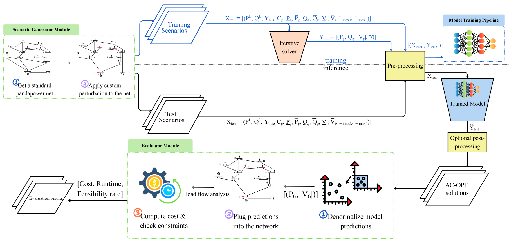

This repository contains the codebase for **STORM-OPF: Robustness Benchmarking for AC-OPF Methods**.

## STORM-OPF Workflow

## Repository Overview

The core implementation of the `Scenario Generator Module` and the `Evaluator Module` is located in `src/`.

All baseline implementations are provided under `src/baselines`. Each baseline directory includes its own `README.md` file with instructions for training and evaluation.

## Complete Pipeline

The overall STORM-OPF workflow is as follows:

1. **Choose the correct env**
   Using virtual environments is recommended, since different baselines may require different dependencies. In this implementation, all baselines use the same environment specified in `env_opf.yml`, except for the OPF-DNN baseline. The OPF-DNN baseline requires a separate environment defined in `src/baselines/OPF_DNN/env_opf_dnn.yml`.

2. **Generate stress-test scenarios.**  
   First, choose the stress scenario(s) on which you want to evaluate an OPF solver. In this work, we define 10 scenarios, including the `in_distribution` case. If you want to use these predefined scenarios, run `src/create_scenario_bank.py` to generate the scenario networks. See `src/README.md` for additional details.  

   To add a new stress scenario:
   - add the scenario name to `config.json`, and  
   - register and implement the scenario in `src/stress_test_scenarios.py`.

3. **Train and evaluate baselines.**  
   The repository currently includes 5 baselines. To train or evaluate any of them, refer to the corresponding `README.md` file in that baseline's folder under `src/baselines`.

4. **Add a new baseline.**  
   To integrate a new baseline into STORM-OPF:
   - place the baseline implementation inside `src/baselines`,  
   - use the generated training and test scenarios to prepare the required datasets, and  
   - extend the appropriate evaluator from the relevant `src/global_evaluation_...` file depending on the OPF setting, such as AC-OPF, SC-ACOPF, DC-OPF, or SC-DCOPF.